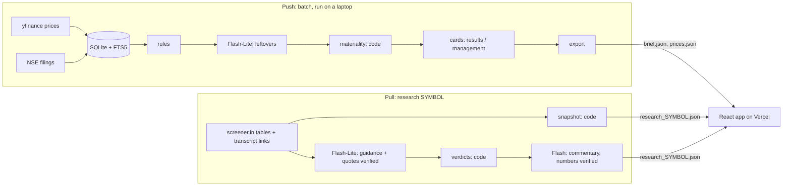

# FINN: Financial Investment Agent

**A triage inbox for a portfolio.** Every filing and price move across 18 holdings is ranked so only a handful reach "Needs you"; routine paperwork folds into one line. Tap a results card and **"Dig in: did they deliver?"** opens a Promise Tracker that checks what management promised on earnings calls against what was delivered, with every number linked to the page it came from.

**Live app:** _[LIVE LINK]_ (best on a phone) · Built for the ENAM Holdings AI Engineer Build Challenge, 1 Nov 2026.

| Brief | Detail sheet | Did they deliver? |
| --- | --- | --- |
| _screenshot_ | _screenshot_ | _screenshot_ |

## What it does

**Push: the Brief** (data as of Fri 30 Oct 2026 close; filings to Sun 1 Nov)
- 120 NSE filings in 10 days across 18 holdings, ranked into **Needs you** (15), **Worth knowing**, and **Routine** (folded). Every card shows *why* it ranks there ("Results · PAT +26% YoY · Vol 3.2×").
- **Results card:** Revenue, EBITDA, PBT, PAT with QoQ and YoY, read from the results PDF. A "checked against filing" tick appears only if every number is found on the cited page and PAT ≈ PBT − tax.
- **Management-change card:** who is joining or leaving, their role and date; for appointments, the person's profile **quoted from the filing's own annexure** (no LinkedIn scraping).
- **Unusual moves:** price ±X% and volume ≥ k× the 20-day average. **You set X and k** on the Rules screen, with a live preview of how many alerts your settings would have produced.

**Pull: Research** (any NSE ticker; 4 pre-built: LT, HAVELLS, CUMMINSIND, ASTRAL)
- **Snapshot:** KPIs, 10-year revenue and margin trajectory, cash conversion (CFO ÷ PAT), debt to equity. All computed in code.
- **Promise Tracker:** guidance from the last 6 earnings calls → verdict per promise (met / partly / missed / still open / can't check), each with the promise quote and the source of the delivered figure. Example: L&T *"group order inflows to grow 10% in FY26"* → **met** (10.0%, reported on the Q4 FY26 call); *"group revenues to grow 15% in FY26"* → **missed** (11.8%).

## How it thinks: code decides, models read

| Always code | Always a model (Gemini) | Never |
| --- | --- | --- |
| Growth, margins, ratios, volume multiples, thresholds, materiality scores, verdicts | Turning filing/transcript text into typed JSON; categorising ambiguous filings; one-line summaries; a short commentary over already-verified evidence | Numbers from the model's memory; news or broker notes on the research side |

**Guards against made-up numbers.** Inputs are only source text. Outputs follow a JSON schema with enums. Every extracted quote must be found in the source page (fuzzy match ≥ 88–90). A summary or commentary that mentions a number not in its source is dropped. Results must pass PAT = PBT − tax. When a check fails, the UI says "couldn't verify, open the filing" instead of showing the number.

**Model routing and cost.** Rules classify 79% of filings with no model. `gemini-3.5-flash-lite` does bulk extraction in batches of 25; `gemini-3.5-flash` only writes commentary. Every response is cached by content hash, so a rerun makes zero model calls. **Total cost: ₹0 (free tier).**

## Measured on real data (1 Nov 2026)

| Check | Result |
| --- | --- |
| Filings classified by rules alone | 95 / 120 (79%) |
| Category accuracy vs 60 hand-labelled filings | _[eval-gold result]_ |
| Results cards that passed both checks | 5 / 7 (the other 2, SUNPHARMA and RELIANCE, were correctly flagged as not verified) |
| Guidance quotes found verbatim in transcripts | 65 / 66 |
| Ranking: "Needs you" before → after judgment rules | 40 → 15 of 120 |

## Architecture



**Push is batch, pull is pre-built.** Both write static JSON, so the app loads instantly on a phone and nothing in the demo depends on a live scraper. User thresholds are applied in the browser, so changing them needs no server.

```
backend/finn/
  ingest/    prices, NSE announcements, screener, PDF download   (network only)
  signals/   rule classifier, materiality, price/volume maths     (pure functions)
  extract/   results + management cards and their validators     (model + checks)
  research/  snapshot, promises + verdicts, build                (code decides)
  llm/       one Gemini client: schema, cache, rate limit, log; prompts/*.md (versioned)
  pipeline.py  CLI
frontend/src/  pages (Brief, Portfolio, Research, Rules), components, lib/rules.ts (tested)
config/        portfolio.yaml, rules.yaml (every weight and default is here)
```

## Run it

```bash
cd backend && pip install -r requirements.txt
export GEMINI_API_KEY=...                 # PowerShell: $env:GEMINI_API_KEY="..."
python -m finn.pipeline prices            # 400 days of EOD prices, writes prices.json
python -m finn.pipeline push              # filings -> rules -> model -> scores -> cards -> brief.json
python -m finn.pipeline research LT       # any NSE ticker; or --demo for the 4
python -m pytest -q                       # 44 tests

cd ../frontend && npm install && npm run dev   # npm test for the rules tests
```

## Source decisions (tested 1 Nov, 13:15–13:50)

| Source | Result | Decision |
| --- | --- | --- |
| Prices: yfinance `.NS` | 18/18 to 30 Oct 2026 | Primary; NSE bhavcopy as fallback (tested) |
| Filings: NSE via `nse` | Works with cookie warm-up | Primary; BSE not needed |
| Fundamentals: screener.in | All tables + 35–46 text transcripts for the research set | Tables for the snapshot; transcripts for guidance |
| LLM: Gemini | `2.5-flash-lite` closed to new keys | `3.5-flash-lite` (bulk), `3.5-flash` (reasoning) |
| Appointment filings | Carry a "brief profile" annexure | Management card quotes the filing |

The full decision log, including what broke and how it was fixed, is in `docs/decision-log.md`.

## Limits, honestly

- Ingestion runs on a laptop (NSE blocks many cloud IPs); production would schedule it from an allowed IP or use a licensed feed.
- screener.in's tables are a standardisation of company filings; results cards use the exchange PDF itself.
- Materiality weights are hand-set (and editable in `rules.yaml`), not learned.
- Segment-level guidance is only checked when management states the segment's actual on a later call.
- Scanned PDFs are detected and skipped, not OCR'd.
